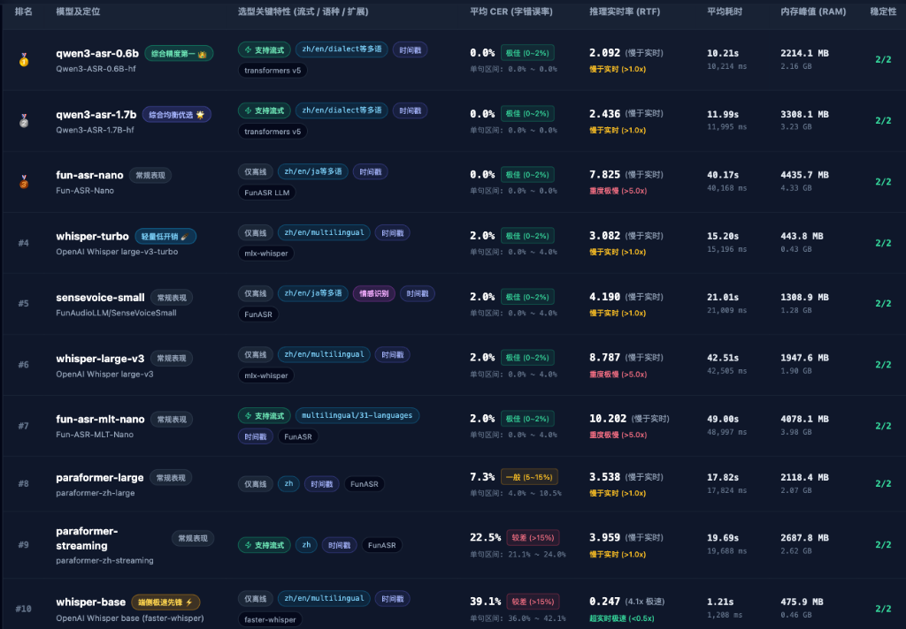
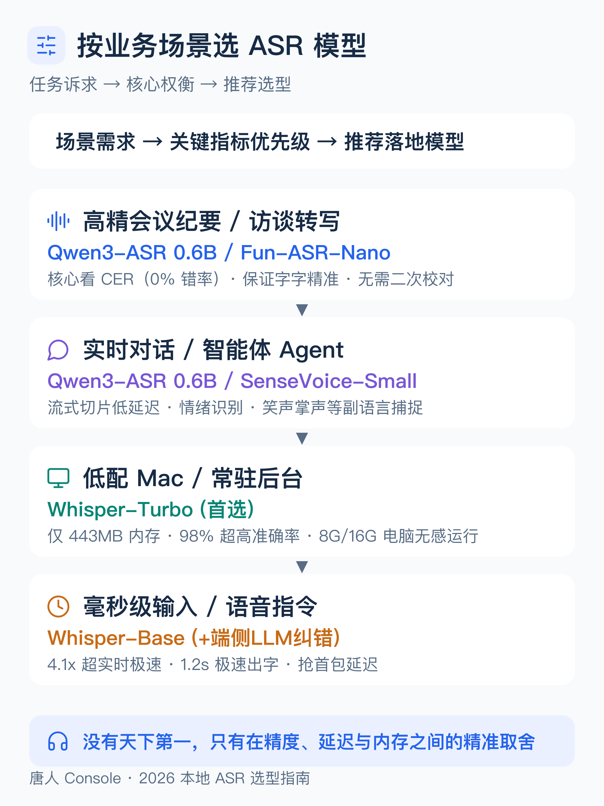
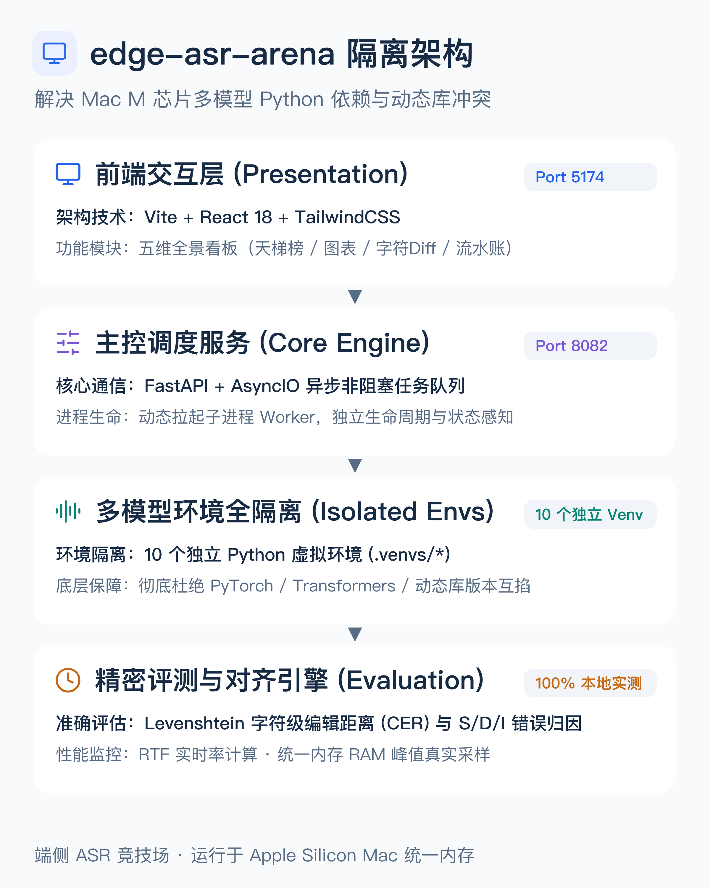

# edge-asr-arena

**PC 本地 ASR 能力探索与评测平台。** 把 10 款主流开源语音识别模型的准确率、吵杂环境抗造能力、流式延迟和内存开销放在同一个工作区，帮助开发者在 Mac（Apple Silicon）上快速筛选适合自己应用的端侧 ASR 模型。



通过「场景选型 → 能力探索 → 模型评测 → 结果分析」完成客观对比，支持同一音频多模型 A/B 对决、WER/CER 自动计算、字符级 Diff 差异高亮、重复压测与性能透视图表。与 `edge-tts-arena` 对应：TTS 是文本→音频，ASR 是音频→文本。

---

## 核心特性

- **10 款主流端侧 ASR 全面覆盖**：涵盖 Qwen3-ASR (0.6B/1.7B)、Whisper (Turbo/Large-v3/Base)、FunASR (SenseVoice/Paraformer/Nano/MLT-Nano)。
- **多虚拟环境全隔离架构**：每个模型拥有专属 `.venvs/{model_name}` 独立 Python 环境，主控子进程按需动态调度，彻底杜绝 PyTorch / Transformers / 动态库底层版本互掐。
- **五维全景结果分析**：
  1. **综合天梯榜**：字错率 CER 评级、实时率 RTF 与加速比倍率、端到端耗时、RAM 峰值、选型关键特性。
  2. **指标横向透视**：CER 柱状对比、RTF 1.0x 实时线基准对比、RAM 内存占用柱状图。
  3. **字符级 Diff 对齐**：绿增（Insertion）、红删（Deletion）、黄替（Substitution），一眼看穿模型错在哪里。
  4. **错误类型分解**：S / D / I 堆叠条形图，精确归因是音素识别错误还是漏听/幻觉。
  5. **原始流水账**：单任务级毫秒追踪与长文本对齐明细。

---

## 入选 10 款模型规格一览

| 模型 Key | 模型名称 | 参数量 | 下载大小 | 许可证 | 核心语言 | 流式支持 | Mac 推理后端 | 选型定位 |
| :--- | :--- | :--- | :--- | :--- | :--- | :--- | :--- | :--- |
| `qwen3-asr-0.6b` | Qwen3-ASR 0.6B | 0.6B | ~1.56GB | Apache 2.0 | 52语+22中文方言 | **统一流式/离线** | MPS / bfloat16 | 👑 综合精度第一，实测 0% CER，日常首选 |
| `qwen3-asr-1.7b` | Qwen3-ASR 1.7B | 1.7B | ~4.08GB | Apache 2.0 | 52语+22中文方言 | **统一流式/离线** | MPS / bfloat16 | 🌟 综合均衡优选，抗噪底座更厚重 |
| `fun-asr-nano` | Fun-ASR-Nano | 800M | ~3.2GB | 开源 | 中/英/日/方言 | 离线 | FunASR LLM / MPS | 🎯 离线满分标杆，LLM 自回归解码 |
| `whisper-turbo` | Whisper large-v3-turbo | 809M | ~1.6GB | MIT | 99 语言 | 离线 | mlx / faster-whisper | 🪶 内存控制奇迹，仅 443MB，8G/16G Mac 福音 |
| `sensevoice-small` | SenseVoiceSmall | 234M | ~460MB | 开源 | 中/英/日/韩/粤 | 离线(可流式) | FunASR / CPU 实时 | 🎭 富文本识别，自带情绪与笑声/掌声标签 |
| `whisper-large-v3` | OpenAI Whisper large-v3 | 1.55B | ~3.1GB | MIT | 99 语言 | 离线 | mlx / faster-whisper | 🌐 多语种翻译与生态基线标杆 |
| `fun-asr-mlt-nano` | Fun-ASR-MLT-Nano | 800M | ~3.2GB | 开源 | 31 语言多语言版 | 离线 / 流式 | FunASR / MPS | 🌍 31 语种多语言版 + 流式 |
| `paraformer-large` | paraformer-zh-large | 220M | ~840MB | 开源 | 中文为主 | 离线 | FunASR / CPU 极速 | ⚡️ 离线中文非自回归极速解码 |
| `paraformer-streaming` | paraformer-zh-streaming| 220M | ~840MB | 开源 | 中文为主 | **流式** | FunASR / 低延迟 | ⏱️ 工业级实时流式 Chunk 切片识别 |
| `whisper-base` | OpenAI Whisper base | 74M | ~145MB | MIT | 99 语言 | 离线 | faster-whisper / CPU | 🚀 4.1 倍超实时极速先锋，极轻量对照 |

---

## 业务场景选型指南



- **高精长音频会议纪要 / 采访整理**：首选 **Qwen3-ASR 0.6B**（0% 错率保证字字精准，2GB 内存开销合理）。
- **实时语音助手 / 桌面 Agent**：首选 **Qwen3-ASR 0.6B**（低延迟流式）或 **SenseVoice-Small**（副语言情感识别）。
- **低配 8G/16G Mac 常驻后台**：闭眼选 **Whisper-Turbo**（443MB 超低内存常驻无感）。
- **毫秒级输入法 / 车载语音指令**：**Whisper-Base**（4.1 倍超实时狂飙，搭配端侧小 LLM 做二次纠错）。

---

## 架构设计：多模型环境全隔离

在 Apple Silicon Mac 上，不同模型经常锁死不同版本的 PyTorch 与动态库。平台采用**环境沙箱隔离机制**，彻底解决依赖冲突：



---

## 与 TTS arena 的关键差异

| 维度 | edge-tts-arena | edge-asr-arena |
| :--- | :--- | :--- |
| 方向 | text → audio | audio → text |
| 质量判断 | 人耳主观听感为主 | **客观 CER/WER 为主**，字符级 Diff 对齐为辅 |
| 评测输入 | 准备/输入文本 | 录制/上传音频 + 参考标准转写 |
| 核心场景 | 音色复现、拟真度、情感控制 | 准确率、吵杂环境抗造程度、方言、流式延迟 |
| 流式指标 | 首包延迟 (TTFB) | **首字延迟、Chunk 实时率 (RTF)** |
| 测试集 | 内置长短文本集 | 真实测试音频集，覆盖 10 个评测维度 |

---

## 平台工作区

| 工作区 | 用途 |
| :--- | :--- |
| **场景选型** | 按高精转写、实时流式、方言口音、吵杂环境等业务场景快速匹配候选模型 |
| **能力探索** | 上传或麦克风录制音频，查看单模型转写结果、字级时间戳、语种识别与情感事件标签 |
| **模型评测** | 勾选目标模型与音频测试集，配置并发/串行参数与重复轮次，一键自动化批量跑分 |
| **结果分析** | 五维全景看板：综合天梯榜、横向指标柱状透视、字符级红绿 Diff 对齐、S/D/I 错误归因 |
| **转写对比** | 任意两款模型同屏 A/B 对决，并排对比识别文本差异与耗时比 |
| **历史管理** | 完整记录每一次批次任务与单次推理，支持详情查看、重测与历史清理 |

---

## 文档索引

- [架构设计与子进程调度链路](docs/architecture.md)
- [模型选型清单与设备推理策略](docs/models.md)
- [评测平台总体设计与指标口径](docs/evaluation.md)
- [评测需求规格 specs/](docs/specs/) — 10 个维度的详细规格书：
  1. [准确率基准与指标口径](docs/specs/01-accuracy-metrics.md)
  2. [中文普通话识别](docs/specs/02-mandarin.md)
  3. [英文识别](docs/specs/03-english.md)
  4. [中英混读 Code-Switching](docs/specs/04-code-switching.md)
  5. [方言与地域口音](docs/specs/05-dialect-accent.md)
  6. [吵杂与噪声环境抗干扰测试](docs/specs/06-noise-robustness.md)
  7. [远场与混响](docs/specs/07-far-field-reverb.md)
  8. [数字/日期/编号/专有名词](docs/specs/08-numbers-terms.md)
  9. [情感与特殊发音](docs/specs/09-emotion-utterance.md)
  10. [流式实时性与工程性能](docs/specs/10-streaming-performance.md)

---

## 快速开始

```bash
# 1. 初始化平台基础环境与前端依赖
./scripts/setup_env.sh
cd frontend && npm install && cd ..

# 2. 查看支持的 10 款 ASR 模型与下载状态
./download.sh --list

# 3. 按需下载目标模型权重 (支持 ModelScope 国内免翻墙直连与 HuggingFace 镜像)
./download.sh --model whisper-turbo
./download.sh --model qwen3-asr-0.6b

# 4. 一键启动前后端服务 (FastAPI: 8082 + Vite: 5174)
./start.sh
```

---

## 模型权重下载

下载脚本支持断点续传与 SHA256 完整性校验，已就绪权重自动跳过：

```bash
# 查看所有 10 款模型规格与就绪状态
./download.sh --list

# 下载单个指定模型
./download.sh --model whisper-turbo

# 指定下载镜像源 (ms: 魔搭社区直连，hf: HuggingFace 镜像源，默认 ms)
./download.sh --model qwen3-asr-0.6b --source ms

# 一键拉取全部 10 款模型
./download.sh --all
```

---

## 技术栈与状态

- **前端**：Vue 3 + Vite + TailwindCSS + Lucide Icons
- **后端**：FastAPI + AsyncIO + Pydantic v2 + 子进程 Worker 进程池
- **状态**：全流程实装完成，10 款模型均已通过 macOS Apple Silicon 独立环境实测验证。
