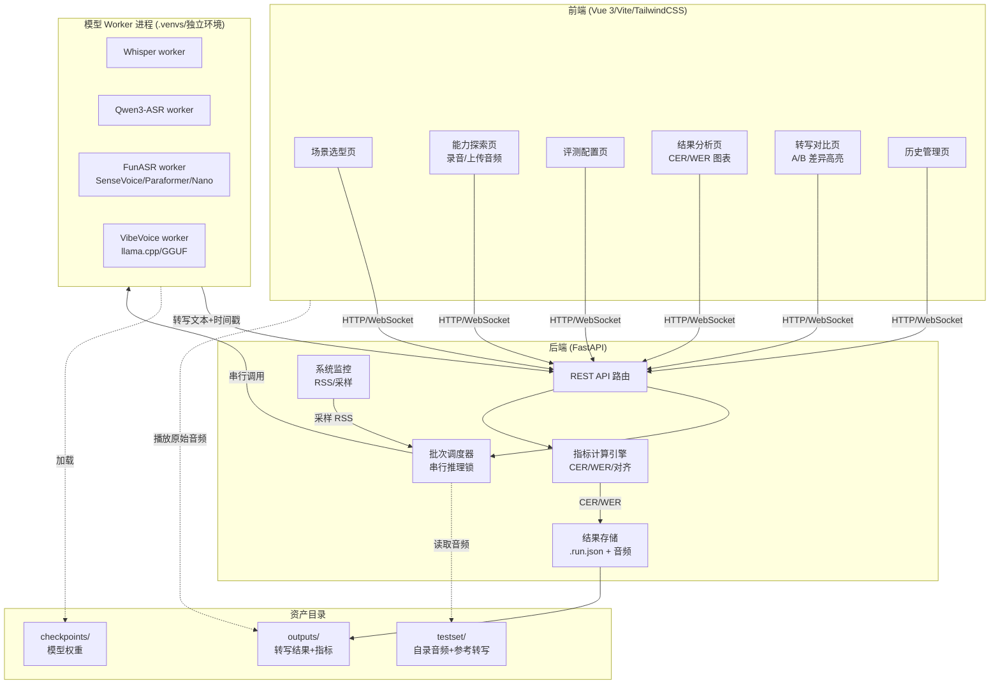
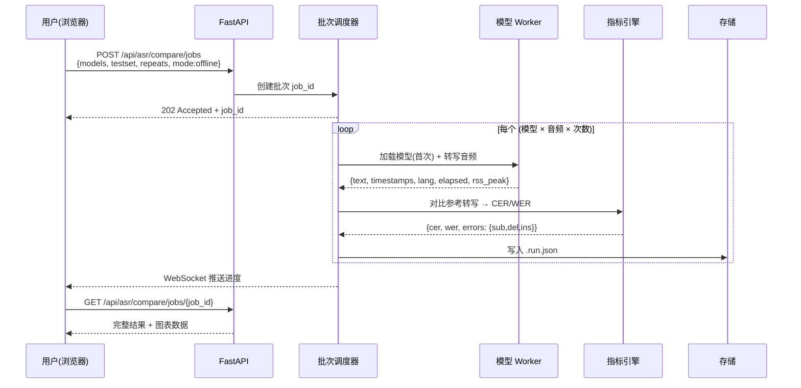
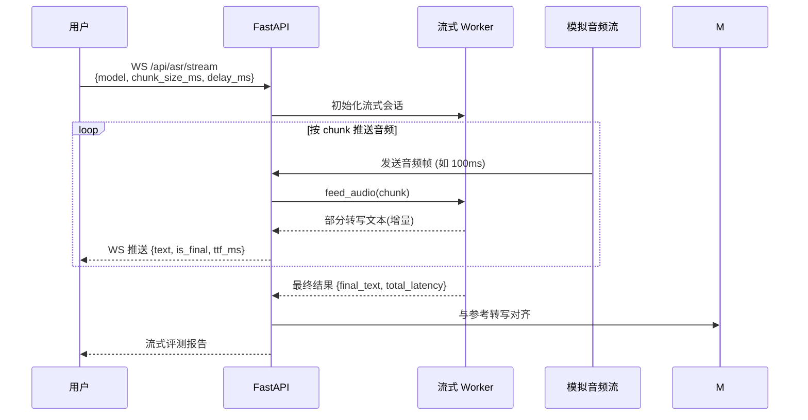
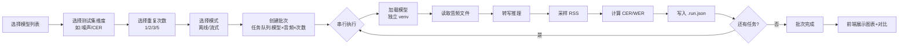

# 架构设计与流程图

[返回 README](../README.md) · [模型选型](models.md) · [评测总体](evaluation.md)

本文档描述 edge-asr-arena 的系统组件、请求链路、批次执行流和数据存储结构。架构对齐 edge-tts-arena 的后端/前端分离模式，但 worker 抽象从「文本→音频」改为「音频→文本」。

## 系统总览



## 核心请求链路

### 离线转写评测批次



### 流式 ASR 评测



## 批次执行流



## 目录结构

```
edge-asr-arena/
├── backend/
│   ├── app/
│   │   ├── main.py              # FastAPI 入口
│   │   ├── core/
│   │   │   ├── config.py        # 模型注册表
│   │   │   ├── model_files.py   # 必要权重文件校验
│   │   │   ├── model_profiles.py # 支持的控制项
│   │   │   └── metrics.py       # CER/WER/对齐
│   │   ├── adapters/
│   │   │   ├── factory.py       # worker 注册
│   │   │   └── base.py          # ASRWorker 抽象基类
│   │   ├── workers/
│   │   │   ├── whisper.py
│   │   │   ├── qwen3_asr.py
│   │   │   ├── funasr.py
│   │   │   └── vibevoice.py
│   │   └── api/
│   │       ├── routes_compare.py
│   │       ├── routes_runs.py
│   │       └── routes_stream.py
│   └── requirements.txt
├── frontend/                    # Vue 3/Vite/TailwindCSS, 对齐 tts-arena
├── checkpoints/                 # 模型权重 (git-ignored)
├── testset/                     # 自录测试音频 + 参考转写
│   ├── 01-mandarin/
│   ├── 02-english/
│   ├── 04-code-switch/
│   ├── 05-dialect/
│   ├── 06-noise/
│   ├── 07-farfield/
│   ├── 08-numbers/
│   ├── 09-emotion/
│   └── manifest.json           # 每条音频:路径/参考文本/SNR/说话人/时长
├── outputs/                     # 转写结果 (git-ignored)
├── scripts/
│   ├── setup_env.sh
│   ├── setup_models.py
│   ├── download.sh
│   └── model_requirements/
├── docs/
│   ├── architecture.md         # 本文档
│   ├── models.md
│   ├── evaluation.md
│   └── specs/                  # 10 份评测需求规格
└── README.md
```

## 数据模型

### `.run.json`（单条转写记录）

```json
{
  "run_id": "whisper-turbo_20261013_001",
  "model_key": "whisper-large-v3-turbo",
  "mode": "offline",
  "audio_file": "testset/06-noise/cafe_snr10_003.wav",
  "reference_text": "请明天下午三点前把报告发给我",
  "hypothesis_text": "请明天下午3点前把报告发给我",
  "language": "zh",
  "timestamps": [...],
  "metrics": {
    "cer": 0.023,
    "wer": 0.0,
    "substitutions": 0,
    "deletions": 0,
    "insertions": 0
  },
  "elapsed_ms": 1240,
  "audio_duration_ms": 3200,
  "rtf": 0.387,
  "memory_peak_mb": 1420,
  "device": "mps",
  "precision": "float16",
  "retry_attempt": 0,
  "status": "success"
}
```

### 流式记录额外字段

```json
{
  "stream_chunks": [
    {"offset_ms": 0, "text": "", "ttfb_ms": null},
    {"offset_ms": 300, "text": "请明天", "ttfb_ms": 312},
    {"offset_ms": 600, "text": "请明天下午", "ttfb_ms": null}
  ],
  "first_token_ms": 312,
  "chunk_interval_ms": 300
}
```

## 关键设计决策

1. **串行推理锁**：与 TTS arena 一致，所有模型转写在同一进程锁内串行执行，避免 MPS/CPU 资源争抢导致指标失真。
2. **独立 venv per model family**：Whisper 用 faster-whisper，FunASR 系用独立 venv，Qwen3-ASR 用 transformers 原生环境，互不污染。
3. **测试集 manifest 驱动**：`testset/manifest.json` 统一描述每条音频的元信息（SNR、说话人、场景标签），批次按维度筛选。
4. **CER/WER 自动计算**：用 `jiwer` 或 `editdistance` 库，先做文本归一化（见 spec 01）再对齐。
5. **失败不进入统计**：与 TTS arena 一致，失败项保留记录但不参与中位数计算。
6. **流式与离线分离**：同一模型若支持两种模式，分别记录；不支持流式的模型在流式批次中自动不可选。
